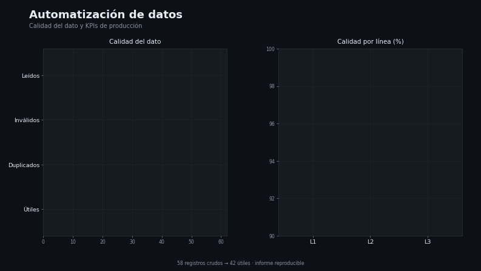

# Capa 3 — Automatización de datos

[`lazarolpro/etl-produccion`](https://github.com/lazarolpro/etl-produccion) · parte del [portafolio de 9 capacidades](https://github.com/lazarolpro/portafolio)

**Capacidad demostrada:** sustituir el armado manual de reportes por un proceso
que limpia los datos, calcula indicadores y emite un informe reproducible.

> © 2026 Ronny L. Díaz López. **Todos los derechos reservados.** El código fuente,
> los datos de detalle y los informes completos son propiedad del autor y no se
> publican. Prohibida su venta o uso comercial sin autorización escrita. Ver
> [`LICENSE`](LICENSE).

## Problema real

Armar el reporte de producción en una hoja de cálculo consume horas, es propenso a
errores y los números no cuadran entre versiones. El dato "sucio" (fechas en varios
formatos, comas decimales, duplicados) obliga a revisar todo a mano.

## Qué hace

- Valida y limpia un CSV de planta (fechas, números, duplicados, inválidos).
- Calcula KPIs de producción, calidad y energía por línea.
- Emite un informe Markdown y un CSV limpio, listos para decidir.

## Demo visual

La animación recorre la limpieza del dato y los KPIs por línea. Video completo:
[`assets/etl_demo.mp4`](assets/etl_demo.mp4).

## Evidencia que produce

- `assets/etl_demo.mp4`, `etl_demo.gif`, `etl_demo_poster.png` — demo visual animado
  (con miniatura).
- [`assets/muestra_informe_produccion.pdf`](assets/muestra_informe_produccion.pdf)
  — muestra resumida del informe de producción (con marca de agua).
- [`data/field_raw.csv`](data/field_raw.csv) — datos de entrada (crudos).
- [`data/field_clean.csv`](data/field_clean.csv) — datos limpios de salida.

## Alcance de este repositorio

Este repositorio es una **vitrina del resultado**: muestra el informe de KPIs, los
datos de entrada y de salida. El **código fuente** y los **informes completos** son
propiedad del autor y se mantienen fuera del repositorio público.

## Stack

Python 3 (solo biblioteca estándar: `csv`, `re`, `datetime`). Sin dependencias.
*(El código no se publica; ver `LICENSE`.)*

## Por qué le importa a la empresa

Ataca la **automatización de tareas repetitivas** y la calidad del dato: menos
trabajo manual, menos retrabajo y métricas confiables para decidir.

**En mantenimiento:** convierte partes de trabajo y lecturas dispersas en
indicadores para planificar mejor.
